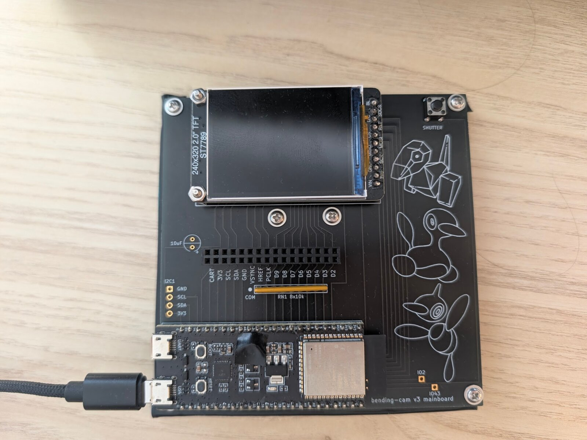

# bendcam

bendcam is a digital camera I designed and built to be glitched on purpose.

<p>
  
  
  
</p>

*Three photos from the camera, as it saved them. All three were taken with the
same plug-in cartridge fitted; [How a bend works](#how-a-bend-works) explains
what that is.*

<p>
  
  
</p>

*The camera. On the front are the screen, the shutter button (top right), the
microcontroller on its own small board (bottom), and between them the
cartridge header, the two rows of black sockets, shown here with nothing
plugged in. The camera module, the small board that holds the lens and the
sensor, looks out of the back.*

One of these cameras exists. Its circuit board is called v3 here, and it
works: it shows a live preview, takes photos, saves them to a microSD card
and sends them to its Android phone app over Bluetooth. This repo is a
snapshot of everything that went into it.

If you have five minutes, `just sim` and `just fuzz` run on a laptop with no
camera ([Try it without the camera](#try-it-without-the-camera)), and
[docs/firmware.md](docs/firmware.md) starts with the four places in the code
worth opening first.

## How a bend works

Circuit bending is rewiring a cheap electronic device so that it misbehaves in
ways you like. With a camera, that normally means opening one up and soldering
onto its board.

In this camera the bend is part of the design. The camera module sends each
pixel to the microcontroller over eight wires, the data lines, one bit on
each. On the v3 board those eight wires don't go straight across. Each one
stops at the cartridge header and starts again on the other side, and only a
cartridge, a small plug-in board, joins the two halves. So the cartridge
decides what the microcontroller sees, nothing is soldered, and a bend comes
out when the cartridge does. A bought camera gives you whatever points on its
board you can find and reach. Here every bit of every pixel has its own pin.

The cartridge that took the photos above is a DIP switch, a row of eight
small switches, one per data line. A closed switch passes its line through. An
open one cuts it, a resistor on the board holds the microcontroller's side
low, and that bit reads 0 in every pixel. Different switch settings give
different pictures.

The header has 16 columns of two pins. Row A goes to the camera module and
row B to the microcontroller.

| Column | 1-8 | 9 | 10 | 11 | 12 | 13 | 14 | 15 | 16 |
|---|---|---|---|---|---|---|---|---|---|
| Signal | D2-D9 | PCLK | HREF | VSYNC | GND | SDA | SCL | 3V3 | CART |
| A and B joined on the board | no | yes | yes | yes | yes | yes | yes | yes | yes |

Columns 1 to 8 are the eight data lines (D2 to D9), with column 1 at the
right-hand end in the photo of the front. Eight plain links across them make
a normal picture. A cartridge can also cross two lines over, so two bits of
every pixel swap places. The other columns are timing, control and power,
which the board joins itself, and CART, a spare line the camera's software
doesn't read yet. Swap cartridges with the power off: a cartridge pushed in
one column too far left or right can short two of the camera module's
outputs.

There is one bend in software too, a setting called `shift`. It draws each
frame starting one byte late, so every pixel's two bytes are read across the
boundary with its neighbour. The colour comes out in hard bands and the
brightness mostly survives. It changes the screen and the screen-sized copy
saved with each photo, not the full-size one.

Photos are saved as raw bitmaps, not JPEGs, because of the bends. The library
that reads the camera module throws away any JPEG that doesn't start with the
right three bytes, so with one data line cut, every JPEG shot times out. A
raw frame has no framing to break and comes through bent.

## How I built it

I had bent cameras before, and stopped because I got bored with the photos:
whichever camera I bought online, I got the same kind of result. A camera
built for bending, where I choose what happens to the data, was the way out,
and for a long time it looked like more than I had time for. This is the first
circuit board I've made.

I built bendcam by directing AI coding agents. They wrote the code; I decided
what the camera should do, tried it on the bench, and chose what got checked
and how. Writing code got cheap that way, but reviewing it didn't, so the
checks are where I put my own work: a simulator that runs the camera's
software on a laptop against fake hardware, a fuzzer, lint and type checks on
the camera's software, and type checks on the phone app.

The checks run on a laptop, and some things only the board could teach me:

- The camera module's clock. A jumper on the module picks its own clock or
  an outside one. Set to the outside one, which this camera doesn't supply,
  the module never answers, which looks exactly like a wiring fault.
- Copying to the board. A plain file copy while the camera's program is
  running is silently lost, and comparing the files from the laptop still says
  it landed. This repo's `just push` command (`tools/push_code.py`) stops the
  program, writes the file, and checks it from the board's side.
- A failed SD card start. If the card fails to start, the board crashes at
  the next garbage collection, unless the firmware holds on to one of the
  card's pins itself. So it does, in `Card.attach`.
- Bluetooth. A Bluetooth service with more than one value in it crashed the
  board when the program reloaded, so each service has one.
- Power. A dip in the supply, from pushing a card in or a bad USB cable,
  resets the board or drops it off USB with nothing logged.

## What's in the repo

| Part | What it does | Where | Lines |
|---|---|---|---|
| Firmware | The camera's own software: preview, shutter, saving, settings, Bluetooth, crash recovery | `src/code.py` | 2,613 |
| Runtime | The small event and state library the firmware is written on | `src/willow.py` | 457 |
| Bring-up scripts | One test per hardware stage, for a new board | `src/bringup/` | 972 |
| Simulator, fuzzer, tests | Fake hardware, scripted runs, random runs, the runtime's tests | `tools/sim/` | 1,477 |
| Phone app | Settings, photo transfer and review over Bluetooth, for Android; type-checked, no tests | `phone/` | 3,730 |
| Circuit board | The v3 board written as code, earlier test boards, fabrication tools | `pcb/` | 1,753 |
| Host tools | Deploying to the board, Bluetooth from a laptop, bitmap to JPEG | `tools/`, `justfile` | 1,852 |

The firmware is Python (CircuitPython) on an ESP32-S3 microcontroller. Three
longer documents hold the detail:

- [docs/simulator.md](docs/simulator.md): how the simulator and the fuzzer
  work, and what they can't see.
- [docs/firmware.md](docs/firmware.md): how the firmware is put together,
  what happens when you press the shutter, and where to start reading the
  code.
- [docs/building.md](docs/building.md): the circuit board, the parts, and
  getting the firmware onto a board.

## Try it without the camera

You need [just](https://github.com/casey/just), Python 3.9 or newer, and
[uv](https://docs.astral.sh/uv/). These are the results on my laptop:

```sh
just sim      # 18 of 18 scenarios the same, in under 2 s
just fuzz     # 0 of 200 seeds failed, in about 25 s
just dev      # once: a .venv with the type stubs for this board
just check    # ruff: All checks passed; pyright: 0 errors
just test     # 13 tests of the runtime, OK
```

`just sim` runs the simulator. It takes two versions of the firmware, the
`main` branch and your working copy by default, and runs each on the laptop
against fake hardware (Python stand-ins for the screen, the card, the camera
module and the radio), recording every call that would have reached the real
thing: what was drawn, what was written to the card, what went over
Bluetooth. Each version goes through 18 scenarios. A scenario is a script of
events, such as shutter presses, the card pulled out in the middle of a save,
or a phone connecting and dropping. Then the two recordings are compared, and
a refactor should come back `same` on all 18.

`just fuzz` runs the fuzzer: a random scenario per seed, checked against
rules such as "no file is written twice" and "every photo taken is either
saved or reported lost", with no second version.

To see both catch a bug, break the number that goes in each photo's file
name so it stops going up after the first shot. In the function `Card.claim`
in `src/code.py`, change `self.seq += 1` to `self.seq = max(self.seq, 1)`:

```
$ just sim
13 of 18 scenarios the same        (so 5 differ)
$ just sim presses
DIFF  presses        4498 vs 4498 lines
      -file rename /sd/_screen.tmp /sd/IMG_0002_screen.bmp
      +file rename /sd/_screen.tmp /sd/IMG_0001_screen.bmp
$ just fuzz --seeds 150
FAIL seed 149: written twice: /sd/IMG_0001_screen.bmp; shot 1 after shot 1; ...
120 of 150 seeds failed
```

The fuzzer only checks its rules. With a different bug, where that number
never goes up at all, no shot is ever taken, no rule is broken, and 0 of 150
seeds failed. For that bug, `just sim` found differences in 13 scenarios.

The fake hardware was written from the same understanding of the real
hardware as the firmware. So `same` means two versions behave alike against
the fakes, not that either is right on the board.

## Building one

The parts on the v3 board are an ESP32-S3-DevKitC-1 N8R8 (the
microcontroller board), Adafruit's OV5640 camera breakout (the camera module,
product 5840), Adafruit's 2.0-inch 320x240 screen with a microSD slot
(product 4311), a pushbutton, an 8x10k resistor network, a 10 uF capacitor
and the 2x16 cartridge header.

The board is written as code in `pcb/v3/v3.circuit.tsx`, and the files a
board factory needs are generated from it.
[docs/building.md](docs/building.md) has those commands, the steps to put the
firmware on a board, and how to use the bring-up scripts on a new board.

What a stranger doesn't get here: there are no design files for a cartridge
and no parts prices, and I haven't run the firmware steps on a second board.

## About this snapshot

This is a public snapshot, as of October 2026, of a private repo. While the
repo was private, its code comments and design notes held personal details,
so I stripped them all rather than edit them one by one; this README and the
three documents in `docs/` carry the design reasoning. Third-party files
(Adafruit's libraries and firmware, the vendors' board files) are left out,
and the `just` recipes fetch them.

Claude wrote this README from my notes and decisions.
